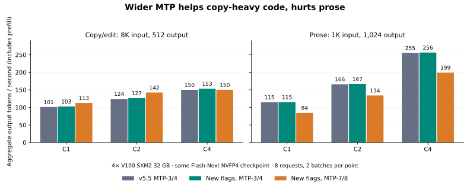

# Flash-Next C1–C4 optimization screen

Native MTP-7/8 reached **216.5 and 219.7 decode tok/s** in two batches of
single-client copy/edit requests on four V100 SXM2 32 GB GPUs. The matched
MTP-3/4 baseline reached **181.4 tok/s**. That is about **20% more decode
throughput**, or **11% end-to-end** after including cold 8K prefill. All 24
first-repeat code outputs at C1/C2/C4 matched the baseline output hashes.

This is a workload-specific result, not a general 200 tok/s result or a world
record claim. Prose regressed substantially with the wider draft, and the
natural-EOS SPEED screen also slowed down. The office service keeps the v5.5
MTP-3/4 eight-request profile. The three runtime experiments in this change are
**opt-in and disabled by default**.



## Configuration and measurement

- Target and native MTP checkpoint: `RadixArk/Qwen3.8-Flash-Next-NVFP4`, revision
  `7b719225242aacd3dbd3f9407468c2ee9a9d2594`.
- Baseline: `23c879b38c6114ce3effd96baa052955b31dbcc1` (v5.5), four V100 SXM2
  32 GB, TP4, NVLink, 300 W limits, FP16 KV, full target and draft vocabulary.
- The 262,144-token context, 277,280-token KV pool, 48 Mamba slots, 2K prefill
  chunks, intermediate prefix checkpoints and CPU image preprocessing remain.
- Fixed prose: eight independent requests, about 1K input and 1,024 output
  tokens, C1/C2/C3/C4. Fixed copy/edit: eight independent requests, about 8K input
  and 512 output tokens, C1/C2/C4. Two batches per candidate and concurrency.
- Temperature 0, seed 42, thinking off, fixed output budget with EOS ignored.
  SPEED uses 20 cases with natural EOS and one batch at C1/C4; it is a small
  workload screen, not a comprehensive quality or throughput evaluation.
- Each timed batch flushes caches, and each agent has a distinct early prompt
  prefix. Warmup is outside timing. Input/output hashes, token counts, acceptance,
  streamed token timestamps, memory and failures are retained.

Aggregate throughput is completed output tokens divided by whole-batch wall
time, including prefill and queueing. Decode is a per-request streamed-token
rate after the first token; table entries average the two batch medians.
Per-stream decode rates are never summed to claim aggregate throughput. The
216–220 result spans fixed 512-token responses, rather than a single HTTP packet.

Runs were sequential: baseline, compact, wide8, adaptive, pristine adaptive
control, restored baseline. The second repeat reverses concurrency order. This
is **not randomized interleaved A/B**; the restored control is necessary when
interpreting small differences. All reported improvements below initially use
the fresh pre-experiment baseline. Complete controls are in [summary.json](summary.json).

## End-to-end results

`compact` enables all three new flags with the original MTP-3/4 and cap8.
`wide8` enables the same flags with MTP-7/8 and cap4. These are combined
experiments; their full-model gains cannot be attributed to any single flag.

| Workload / clients | v5.5 baseline | Compact | Wide8 |
| --- | ---: | ---: | ---: |
| Prose C1 | 114.8 | 115.1 | 84.3 |
| Prose C2 | 166.0 | 166.8 | 134.0 |
| Prose C3 | 198.9 | 198.9 | 158.6 |
| Prose C4 | 255.1 | 256.2 | 199.2 |
| Copy/edit C1 | 101.1 | 102.7 | **112.6** |
| Copy/edit C2 | 124.2 | 126.7 | **142.3** |
| Copy/edit C4 | 149.7 | 153.4 | 150.0 |

Units are aggregate output tok/s. See the machine-readable summary for exact
per-batch values. Compact's roughly 0–0.5% prose differences are within ordinary
run variation; its 1.6–2.5% copy/edit differences require stronger confirmation.
Wide8 improves copy/edit end-to-end by about 11.4% at C1 and 14.6% at C2, but
gives essentially no C4 aggregate improvement.

The restored v5.5 profile, with all three flags off, measured the following
single-batch controls after the experiments:

| Workload / clients | Initial baseline (two-batch mean) | Restored control |
| --- | ---: | ---: |
| Prose C1 | 114.8 | 115.6 |
| Prose C2 | 166.0 | 166.2 |
| Prose C3 | 198.9 | 198.6 |
| Prose C4 | 255.1 | 252.0 |
| Copy/edit C1 | 101.1 | 101.0 |
| Copy/edit C2 | 124.2 | 126.5 |
| Copy/edit C4 | 149.7 | 153.3 |

The restored C2/C4 copy/edit rates almost match compact. Its apparent gains
there cannot be confidently attributed to the new kernels. Wide8's copy/edit
C1 gain remains about 11.5% end-to-end against this control; C2 is about 12.5%,
and C4 is about 2.2% slower. This supports keeping the new flags optional and
retaining the balanced office profile.

| C1 per-stream decode | v5.5 baseline | Compact | Wide8 |
| --- | ---: | ---: | ---: |
| Prose | 119.0 | 119.2 | 87.2 |
| Copy/edit | 181.4 | 182.0 | **218.1** |

This copy-heavy prompt is unusually favorable to speculation: C1 produces
4.00 output tokens per verification with MTP-3/4 and 7.78 with MTP-7/8. These
counts include the target token. C1 prose rises only from 2.56 to 3.04 output
tokens per verification, which does not pay for the wider round.

NVML samples from all 16 C1 copy/edit requests measured mean decode power of
169.7 W/GPU for the baseline and 162.5 W/GPU for wide8. The windows exclude
0.6 seconds after TTFT and before the last token; there are 126 baseline and
91 wide8 samples across the requests. All sampled SM clocks were 1,530 MHz,
without throttle flags. These short-window power readings are not a whole-job
energy benchmark, but they illustrate why higher throughput need not mean
higher watts. Better acceptance amortizes each target verification.

Compact's C8 fixed-text batches reached 360.5 and 365.0 aggregate tok/s;
the restored v5.5 control reached 361.3. Compact's natural-EOS SPEED
screen reached 119.7 at C1 and 234.2 at C4; wide8 reached 97.3 and 207.0. There
was no initial SPEED control in this round, so comparison to the restored
control is reported separately rather than silently substituting an older run.

The restored SPEED control reached 120.8 aggregate tok/s at C1 and 233.3 at C4.
Compact is therefore about 0.9% slower at C1 and 0.4% faster at C4, within this
screen's run variation. Wide8 is about 19.4% slower at C1 and 11.3% slower at
C4. Its copy-heavy result does not transfer to this more varied workload.

The adaptive experiment used candidate steps `[3, 7]`, EMA alpha 0.2, update
interval 5, 10 warmup batches, up hysteresis 0.2 and down hysteresis 1.0. It
initially passed the functional gates but reduced prose acceptance and collapsed
copy/edit acceptance to about 1.21 output tokens per verification. A later
7→3 transition during SPEED triggered an out-of-bounds CUDA indexing assertion.
The stack surfaced at an asynchronous result synchronization point; it does
not identify the originating kernel. A separate worktree at pristine v5.5,
with all three new flags off and pinned native dependencies, reproduced the
C1 prose slowdown (about 105 decode tok/s), the C1 copy/edit acceptance
collapse (1.22 output tokens per verification, about 56 decode tok/s), and the
CUDA indexing failure during the subsequent SPEED width-transition test.
The acceptance loss was already present before any runtime width switch.
This isolates the failure to the pre-existing adaptive configuration on this
model/backend; it does not establish the precise faulty kernel or state update.
Adaptive operation is excluded from the office configuration.

## What was implemented

`SGLANG_SM70_MTP_LOCAL_TOP1=1` keeps the native MTP head's entire vocabulary
but exchanges each TP shard's best value and global token ID, instead of
gathering every draft logit. It requires SM70 FP16 native Qwen MTP, topk1 and
ordinary TP, with no hot-vocabulary map, LoRA, pipeline parallelism or logit
transforms. Target verification and sampling retain their full logits. Ties
select the lowest global ID. The graph runner uses the local logit width.
The real TP4 selection/communication screen was slightly slower at one row
and faster at multiple rows; this is not an equivalent full-model speedup.

`SGLANG_SM70_HC_COMBINE_NORM=1` fuses residual combination with the following
grouped Gemma RMSNorm at the attention-to-MLP boundary. It preserves the FP16
combined residual and the existing norm reduction order. It supports only
the measured HC4/hidden2560 SM70 FP16 layout and falls back for other layouts.
The isolated operation improved by 1.18–1.35×, saving roughly one microsecond
per invocation. Existing gate partials are reused where available. CUPTI
captures confirmed the fused kernel ran in both C1 and C4 serving.

`SGLANG_SM70_AR_PUSH16=1` uses 16 push CTAs for the full-NVLink TP4 SM70
communicator, unless the caller explicitly supplies another block count. The
small-message microbenchmark saved roughly 0.2–0.6 microseconds. The reset/copy
needed by the in-place all-reduce benchmark is included equally in both arms.

None of these flags is enabled by the office launcher. The optional wide8
experiment can be reproduced with the existing launcher and extra arguments:

```bash
SGLANG_SM70_MTP_LOCAL_TOP1=1 \
SGLANG_SM70_HC_COMBINE_NORM=1 \
SGLANG_SM70_AR_PUSH16=1 \
PORT=8083 \
bash scripts/serve_qwen38_flash_next_nvfp4_v100_throughput.sh \
  RadixArk/Qwen3.8-Flash-Next-NVFP4 \
  --speculative-num-steps 7 --speculative-num-draft-tokens 8 \
  --max-running-requests 4 --cuda-graph-bs 1 2 3 4
```

It needs exclusive use of the four GPUs; this command is not a second service
to start alongside the resident office model. It is a measured specialist
experiment, with the prose/SPEED regressions described above.

## Wider screen and next opportunities

| Direction | Evidence and disposition |
| --- | --- |
| Wider native MTP | Strong C1/C2 copy/edit result; workload-sensitive. Retain as an experiment. |
| Adaptive MTP width | Acceptance collapsed and a width transition caused a CUDA indexing assertion, reproduced on pristine v5.5. Rejected for serving. |
| HC combine + norm | Bitwise operator parity and a small isolated gain; opt-in implementation. |
| TP-local draft winner | Full vocabulary and TP4 parity retained; useful multirow microbenchmark, small combined server gain. |
| NVLink collective geometry | Screened push/pull and 1/2/4/8/16 push CTAs at real message sizes; optional 16-CTA path. |
| FP16 WMMA projections | 314 valid shape/configuration records across direct-global, staged shared and skewed shared screens mostly lost. One M16/N640/K2560 case saved about 2 µs (1.18×); not integrated. One oversized static-shared-memory configuration failed compilation and is retained as a failure. |
| cuBLAS algorithm selection | Most shapes tied or lost. HC-up at 12/16 rows has an isolated 15–17% lead worth a later fused-path test; not integrated. Numerically failing algorithms were rejected. |
| HC prefetch / wider scalar tiling | Mostly slower; a 3.8% isolated two-row HC-up improvement was insufficient to justify integration. No serving change. |
| Expert weight reuse across rows | Captured routes offer only about 1.0–1.95× grouping opportunities. An optimistic preplanned-pair kernel mostly lost even before charging route-planning cost. Rejected. |
| Multi-block greedy reduction | Investigated through local shard top-1 exchange; standalone argmax microbenchmark is not enough to justify another runtime kernel. |
| GDN verification fusion/state commit | Existing local fused path overlaps the reference. A wider controller must preserve rejection rollback and recurrent state. No new standalone speedup demonstrated. |
| QSA metadata and batched KV writes | Existing graph preparation/direct-cache work covers much of the reference. No additional end-to-end gain established in this round. |
| Prompt lookup + MTP | Earlier local history coordination and edit-boundary acceptance losses remain unresolved. Do not repeat the same implementation without addressing those costs. |
| PLE/CPU scheduling | PLE is in one target layer here; no evidence that it dominates steady decode. Extra host RAM does not automatically accelerate it. |
| KV precision / reduced draft vocabulary | Keep the earlier FP16 KV and full-vocabulary decisions. No new precision or vocabulary restriction in this screen. |

The next substantial general-purpose opportunity is making wider speculation
safe and acceptance-aware across workload changes. The fixed-width result
shows potential, but the failed adaptive experiment does not establish a safe
controller. HC-up projection epilogues are a smaller, concrete follow-up.
More power draw alone is not the objective: the [previous core audit](../qwen38_concurrent_core_audit_20261104/README.md)
found maximum SM clocks without throttling, low Tensor activity at small batches,
and substantial projection, MoE and collective time. This round's microbenchmark
losses show why filling those Tensor Cores with poorly shaped work can slow
the server down.

## Correctness and limitations

Compact and fixed wide8 passed all eight text/full-context/rejection-recovery
checks, tool calls and shared-document checks with at least 30,720 cached
tokens per answer. Both retain the same multimodal baseline: 11/12, with the
known `V10 CHECK 4827` OCR miss. These results do not establish byte-identical
full-model output: code hashes match, but some prose outputs diverge later in
generation, and baseline C3 prose was itself not repeatable. Operator bitwise
tests and functional model checks are different evidence.

The draft selector passed 11 CPU tests and real four-rank GPU checks including
ties, padding, nonfinite values and graph replay. HC combination/normalization
passed 11 bitwise GPU tests against the existing operators with nonzero norm
weights and graph replay, covering every advertised row count. The
all-reduce screen passed exact parity after fixing the benchmark's repeated
in-place reduction overflow. Failed harness/compiler runs are retained.

The new optional profiles were not subjected to a new 48-request document queue
test or 32-image stress test. The office profile remains the already validated
v5.5 configuration. After restoration, eight simultaneous arithmetic requests,
streaming and the 32-image request passed on port 8082. The image request took
12.73 seconds with at least 3,019 MiB free on GPU 0, followed by HTTP 200 health.
The user service reports zero automatic restarts. No Docker image was rebuilt.

## Provenance and acknowledgments

Thanks to the Strata and Strata-V100 contributors for publishing inspectable
Volta kernels and candid benchmark notes. Their gated-residual scheduling,
greedy selection and verification work helped focus this screen. The local
CUDA implementations use the existing SGLang operators; no Strata CUDA source
was copied into the runtime. Strata's inspected source is MIT licensed.

- [Strata V100 guide](https://github.com/Niko1221/Strata/blob/ffa80d73133ea5c548aefe57889a16e8085a938f/docs/NVIDIA_V100.md)
- [Strata gated residual kernels](https://github.com/Niko1221/Strata/blob/ffa80d73133ea5c548aefe57889a16e8085a938f/src/kernels/cuda/fused_gr.cu)
- [Strata V100 decode report](https://github.com/Niko1221/Strata/blob/ffa80d73133ea5c548aefe57889a16e8085a938f/bench/results/2026-10-07-v100-decode-kernels/README.md)
- [Strata-V100](https://github.com/jmnargi/Strata-V100/tree/4c56f005eb27c69406343d13da68d1bc38f5ce48)

The cited 200+ burst comparison was for a 27B model. Different model sizes,
quantization, prompts, draft acceptance, output lengths and concurrency cannot
establish a Flash-Next record. DFlash was excluded from this work.

[metadata.json](metadata.json) hashes the raw artifacts and retained local
traces. [summary.json](summary.json) is generated from request-level results;
the raw archive includes failures, launch configurations, benchmark scripts,
source prototypes, the synthetic fixed-workload token corpus and validation logs.
SPEED input hashes and its existing corpus builder are retained; the original
dataset prompts are not republished here. Generated benchmark prose is omitted,
while output hashes and streamed token timestamps remain. The original host
directory is `/home/rah/qwen38-runs/20261104-c14-strata-round`.
