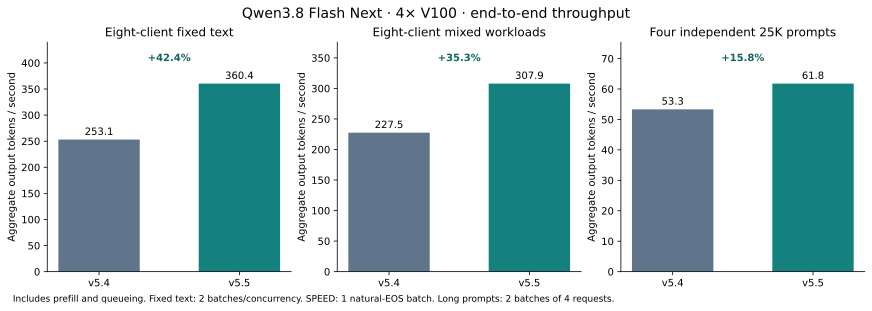
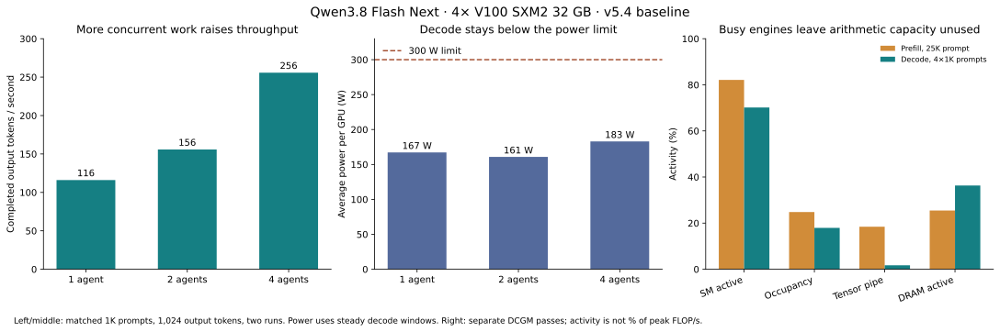

# Concurrent Qwen3.8 V100 core audit

The selected **v5.5 eight-request profile** raises fixed-output eight-client
throughput from **253.1 to 360.4 tok/s (+42.4%)**, and the natural-EOS SPEED
screen from **227.5 to 307.9 tok/s (+35.3%)**. It keeps native MTP-3/4, 2K
prefill, 262K context, shared-prefix checkpoints and the v5.4 vision backend.
Four-client and single-client performance are preserved within this screen.

The v5.4 server has unused arithmetic capacity even while `nvidia-smi` reports
about 99% GPU activity. Decode is not held back by the 300 W power limit:
measured steady windows ran at the maximum 1,530 MHz SM clock without throttle
flags. Increasing useful work per launch matters more than increasing watts.

The audit uses four V100 SXM2 32 GB GPUs with NVLink, TP4, FP16 KV, native
MTP-3/4, four running requests, a 277,280-token KV pool and 262K context.
Baseline source is `0f7544834c`; the checkpoint revision is
`7b719225242aacd3dbd3f9407468c2ee9a9d2594`. CPU image preprocessing, the v5.4
vision backend and shared-document prefix checkpoints remain enabled.

## What the power readings mean

Matched 1K-input/1,024-output-token requests, two runs per offered concurrency:

| Active clients | Aggregate output | Mean steady decode power per GPU |
| --- | ---: | ---: |
| 1 | 116.1 tok/s | 167.3 W |
| 2 | 155.8 tok/s | 160.8 W |
| 4 | 255.8 tok/s | 183.0 W |

Throughput includes prompt processing. Power samples come from the interval
when every client is decoding, with a 2.2-second guard at both boundaries.
These are different measures of the same runs; the table is not a whole-request
energy benchmark. Small power differences depend on workload and timing.

DCGM activity, averaged across GPUs in guarded windows:

| Workload | SM active | SM occupancy | Tensor pipe | DRAM active |
| --- | ---: | ---: | ---: | ---: |
| Initial prefill, one 25K prompt | 82.1% | 24.8% | 18.4% | 25.5% |
| Decode, one 25K prompt | 57.6% | 19.5% | 0.2% | 31.7% |
| Decode, two 25K prompts | 63.0% | 14.3% | 2.0% | 30.1% |
| Decode, four 1K prompts | 70.2% | 18.0% | 1.7% | 36.3% |

The four-client row uses short prompts so all clients remain in decode together
long enough to measure. With four independent cold 25K prompts, some clients
finish before the last reaches decode; those mixed intervals are excluded.
This is also a scheduling limitation for agents reading independent documents.
Shared-prefix reuse is tested separately.

SM activity counts resident active warps, including those waiting for memory.
Tensor activity measures active instruction-pipe cycles; DRAM activity counts
cycles with memory transfers. None is a direct percentage of peak FLOP/s or
peak GB/s. Higher occupancy alone does not establish higher throughput.
SM/occupancy and Tensor counters were collected in separate passes, as required
by the V100 counter groups. See [NVIDIA's metric definitions](https://docs.nvidia.com/datacenter/dcgm/latest/user-guide/feature-overview.html#metrics).

## Where GPU time goes

The diagnostic four-client trace attributes about 25.3% of summed GPU kernel
duration to dense/dot projections and 24.6% to MoE. Collective kernels account
for 22.4%, including synchronization waits. Generic matrix kernels include
hyperconnection and GDN projections; this trace does not attribute every one
to its owning layer. The 70K prefill trace attributes about 30.9% to MoE,
21.4% to dense projections and 15.4% to QSA.

Kernel sums overlap across streams and are not additive wall-clock latency.
Tracing adds overhead and can enlarge inter-rank waits; the traced idle
fractions of 23–29% during decode are not an untraced optimization budget.
The untraced throughput and DCGM passes are separate from trace capture.

Nsight Compute's per-kernel counters remain unavailable under the host's
counter-permission policy, and passwordless sudo is unavailable. The audit
uses the existing privileged DCGM host engine, CUPTI timelines and compiler
resource reports. It does not claim measured instruction-stall reasons or
per-kernel achieved occupancy.

## Experiments selected from the audit

The existing small-row fusions stop at two or four tokens, while concurrent
MTP verification produces eight, twelve or sixteen token rows. A screen of
123 kernel/configuration combinations retained two contained changes:

- Shared-expert gate: preserve the existing independent per-row arithmetic
  for 8/12/16 rows. The isolated operation falls from about 9.0–9.2 microseconds
  to 3.0 microseconds, replacing projection, sigmoid and multiply launches.
- GDN projection/layout fusion: enable eight rows, where the measured combined
  operation falls from 60.69 to 45.13 microseconds (1.34×). Twelve and sixteen
  rows remain on the existing path because the extension did not win there.

Both are behind `SGLANG_SM70_BATCHED_FUSIONS=1`; existing two/four-row behavior
is unchanged. The independent shared-gate implementation also supports
20/24/28/32 verification rows, with the same per-row arithmetic. These isolated
gains do not imply a 3× or 1.34× server gain.

Widening scalar dense and hyperconnection kernels was mostly slower. The
16-row dense prototype uses 254 registers per thread; the HC prototypes use
up to 182. This is consistent with low occupancy limits and the measured
losses. No local-memory spills were reported in the inspected binaries.
Volta has 64K 32-bit registers per SM and a 255-register per-thread limit;
[the Volta tuning guide](https://docs.nvidia.com/cuda/volta-tuning-guide/index.html#occupancy)
explains the resource constraints. These failed prototypes stay out of serving.

The 4K prefill experiment extended grouped Page4 attention to larger chunks.
It passed all eight text checks, including 262K retrieval, and the tool test.
Every shared-document answer was correct, but one prefix hit fell from 30,720
to 28,672 tokens because the chunk boundaries create more widely spaced
checkpoints. That failed the existing shared-document cache gate. The 4K
dispatch change was reverted and its patch retained as a rejected experiment;
no full-model throughput gain is claimed. The office profile keeps 2K chunks.

The selected candidate keeps MTP-3/4 and admits eight requests. The native MoE and
top-k entry points accept up to 32 verification rows behind
`SGLANG_SM70_BATCHED_MOE32=1`, in addition to the existing batched-MoE flag.
This changes the number of independent route blocks launched, without growing
per-thread accumulators or changing reduction arithmetic. The default remains
sixteen rows when only the existing batched-MoE flag is enabled.

## Validation and full-model decision

All 43 numerical and CUDA-graph replay tests passed before the rejected 4K
experiment. For the eight-request candidate, 94 ordinary tests passed, covering
batched gate equivalence to individual rows, eight-row GDN equivalence to
existing four-row calls and FP32 references, and larger MoE/top-k batches.

Three explicit 24/28/32-row graph replay tests passed. Six 32-row eager cases
passed CUDA device-memory checking with 4,096-byte allocation padding and zero
device-memory errors. Allocator caching was disabled for that eager pass;
CUDA API probe reports were suppressed as in the previous audit. The initial
sanitizer invocation incorrectly combined disabled allocator caching with graph
capture, causing an unsupported-allocation error before the captured kernel.
The fixtures were separated, and both graph replay and eager memory checking
then passed. That failed harness run is retained in the evidence.

The eight-request profile passed all eight text/full-context/rejection-recovery
checks, tool calls, shared-document reuse (at least 30,720 cached tokens per
answer), and all 48 growing-document requests. The queue test completed in
233.52 s and retained at least 2,952.7 MiB free on GPU 0. Multimodal remains
11/12 with the same `V10 CHECK 4827` OCR miss. The 32-image request completed
correctly in 12.44 s. Single-client follow-up checks measured 116.1–117.3
end-to-end tok/s and 121.2–121.4 decode tok/s.

| Workload | v5.4 four-request profile | v5.5 eight-request profile | Change |
| --- | ---: | ---: | ---: |
| Fixed text, four clients | 253.4 tok/s | 255.6 tok/s | +0.9% |
| Fixed text, eight clients | 253.1 tok/s | 360.4 tok/s | **+42.4%** |
| SPEED, four clients | 228.1 tok/s | 229.5 tok/s | +0.6% |
| SPEED, eight clients | 227.5 tok/s | 307.9 tok/s | **+35.3%** |
| Four independent 25K prompts | 53.3 tok/s | 61.8 tok/s | **+15.8%** |

Fixed text uses two batches per concurrency; SPEED uses one batch and natural
EOS, so its output lengths vary. Small four-client differences are not evidence
of a statistically established gain. With eight simultaneous clients, each
individual stream decodes more slowly than an active stream in the four-request
profile, but requests spend less time queued and total throughput rises.

The baseline for those comparisons is a separate fresh run: eight fixed-output
text requests at four and eight clients (two batches each), four independent 25K requests, and the
20-case natural-EOS SPEED screen. The 25K test has four requests; its client
limits of four and eight both allow at most four active requests and are
reported as two runs of the same four-request workload.

Within the new profile, matched 1K-input/2,048-output-token counter passes show
the following steady decode behavior:

| Metric | Four active agents | Eight active agents |
| --- | ---: | ---: |
| SM activity | 69.5% | 78.5% |
| SM occupancy | 17.7% | 22.8% |
| Tensor pipe activity | 1.7% | 2.6% |
| DRAM activity | 36.2% | 42.8% |
| Mean power per GPU | 184.5 W | 210.7 W |

All sampled SM clocks were 1,530 MHz with no throttle flags in these windows.
This demonstrates greater utilization and output throughput, while substantial
Tensor Core capacity remains unused. It does not imply that raising power
limits would help. Further work should target the small matrix/expert execution
and preserve intermediate recurrent checkpoints when batching larger prefills.

Use `scripts/serve_qwen38_flash_next_nvfp4_v100_throughput.sh`. It enables
`SGLANG_SM70_BATCHED_MOE`, `SGLANG_SM70_BATCHED_MOE32` and
`SGLANG_SM70_BATCHED_FUSIONS`, with eight running requests, graphs 1–8, 48 Mamba
slots and memory fraction 0.86. The KV pool remains 277,280 tokens. The existing
single-request MTP launcher is available separately. These are host results;
no Docker image was rebuilt. [summary.json](summary.json) contains the measured
comparisons and resolved configuration.

Raw request timings retain output hashes and acceptance metadata. Generated
benchmark text is omitted from the public archive. Hardware counters,
configuration, rejected experiment measurements, unit-test output and compiler
resource reports are retained; full profiler traces remain in the local run
directory `/home/rah/qwen38-runs/20261104-concurrent-core-audit`.
