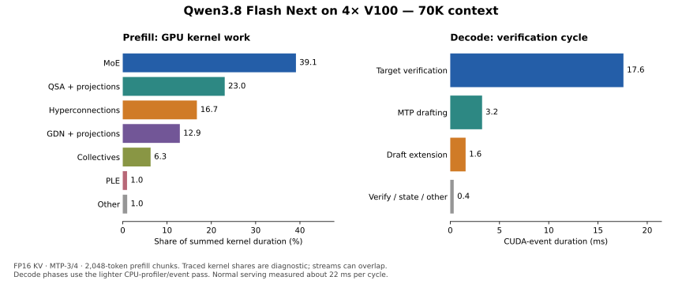
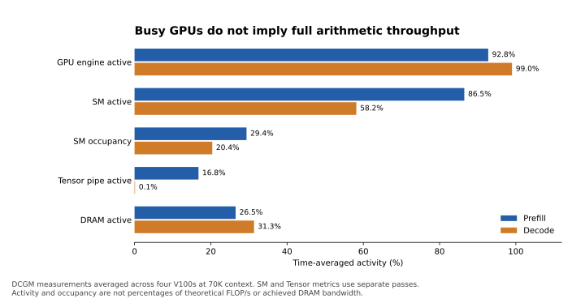

# Qwen3.8 Flash Next V100 core audit — 2026-11-03

The largest prefill costs are MoE, QSA and hyperconnections. Decode is dominated
by target verification: about 17.6 ms of a 22.7 ms instrumented MTP cycle. The
hardware is functioning well in isolated bandwidth tests, but an almost
continuously busy GPU is not the same as saturated arithmetic throughput.

This audit changes benchmark tools and documentation only. The validated v5.1
service was restored on port 8082 with FP16 KV, native MTP-3/4, 2,048-token
prefill chunks, TP4 and a 262,144-token context limit.



## Scope and controls

- Four V100-SXM2 32 GB cards, two NVLink links between each GPU pair.
- Runtime source `2f5dd9e7dfb4b2088a1628cde11f1215bd731a72` / serving tag
  `v100-qwen38-flash-next-v5.1`.
- Model and draft: `RadixArk/Qwen3.8-Flash-Next-NVFP4`, revision
  `7b719225242aacd3dbd3f9407468c2ee9a9d2594`.
- One active request, full draft vocabulary, greedy sampling, thinking disabled.
- Synthetic prose and copy-heavy code prompts; cold prefix caches, warmed
  kernels. Requests use token IDs, so timings exclude tokenization, PDF
  extraction/OCR, client subprocess work and image encoding.
- Separate untraced timings, DCGM counter passes, CPU-profiler/CUDA-event passes,
  and CPU+GPU traces. No clock or power settings were changed.

The dedicated audit endpoint was 8083. Production was stopped with the user's
authorization, then restarted and checked after capture. Restored checks passed
four short/grammar/sampling cases and the tool-call/continuation round trip.
The audit exercised up to 160K input tokens; the earlier v5.1 262K validation is
documented in the [serving incident report](../qwen38_nvfp4_v100_kv_qsa_20261102/serving_oom_20261103.json).

## Normal request timing

| Prose input | TTFT | Decode | Observed cycle |
| --- | ---: | ---: | ---: |
| 1K | 0.30 s | 118.9 tok/s | 21.37 ms |
| 8K | 2.14 s | 114.2 tok/s | 21.63 ms |
| 70K | 19.70 s | 113.5 tok/s | 22.18 ms |
| 160K | about 46.9 s | about 109 tok/s | about 22.9 ms |

The first two rows are medians of two 512-output-token requests after restoring
the service without the diagnostic import hooks. The 70K row is the median of
two dedicated-server baseline requests with hooks inactive. The 160K row is
rounded from the counter-monitored 1,024-output-token requests. They are not a
single identical-output-length comparison. Restored 1K/8K cycle times differed
from the inactive-hook baseline by less than 1%.

The 512-token copy-edit case reached about 182 tok/s with nearly four output
tokens per cycle. That is a synthetic high-acceptance case, not a general coding
result. Forcing that case to 1,024 output tokens continued beyond its useful
answer and lowered acceptance; those longer outputs are retained for hardware
sampling and must not be advertised as useful code throughput.

## What occupies the GPU during prefill

Rank-zero 70K trace, exclusive semantic attribution of **summed kernel
durations**, using CUDA launch correlations and enclosing model ranges:

| Component | Share |
| --- | ---: |
| MoE, including routing/shared expert work | 39.1% |
| QSA, including its projections | 23.0% |
| Hyperconnection mixing/combining | 16.7% |
| GDN, including its projections | 12.9% |
| Collectives | 6.3% |
| PLE | 1.0% |
| Remaining work | 1.0% |

The two largest Marlin kernels accounted for 5.88 s of the 18.01 s summed GPU
kernel duration. The sparse prefill kernel alone accounted for 3.08 s, or 17.1%.
The full traced prefill interval was 20.69 s. GPU work inside that interval
covered about 18.02 s; the remaining traced gaps include profiler effects and
must not be interpreted as an untraced idle budget.

At 8K, MoE was 42.4%, QSA 18.0%, hyperconnections 18.0%, and GDN 13.8%.
The four ranks' 70K prefill busy durations differed by approximately 1.2%; no
single GPU was an obvious persistent straggler.

## What occupies a decode cycle

The lighter CPU-profiler/event pass at 70K recorded 53 cycles:

| Phase | Median CUDA-event duration |
| --- | ---: |
| MTP drafting | 3.23 ms |
| Target verification forward | 17.58 ms |
| Recurrent-state commit | 0.19 ms |
| Remaining verification overhead | about 0.15 ms |
| Draft extension | 1.56 ms |
| Complete cycle | 22.73 ms |

Target verification is approximately 77% of this cycle. CPU submission took
7.57 ms and overlaps GPU execution; it must not be added to the cycle duration.
Recurrent-state commit is below 1% of the cycle.

The GPU trace's decode kernel-duration categories were approximately 26.9%
dense/dot projections, 17.4% MoE, 15.5% hyperconnections, 12.2% normalization and
pointwise work, 7.6% fused GDN kernels, 5.0% copies, 4.8% QSA, 4.6% collectives,
and 6.1% PLE/other work. These are kernel-name categories for captured graphs,
not a complete attribution of every dense projection to its owning layer.

Tracing raised the measured cycle from roughly 22 ms to 27.9 ms. The trace's
28% decode idle fraction is therefore **not** evidence that 28% of ordinary
serving time can be removed. Kernel sums also overlap across streams, so they
are not additive wall-clock latency.

## Hardware activity and calibration



70K context, averages across the four GPUs:

| DCGM metric | Prefill | Decode |
| --- | ---: | ---: |
| GPU engine active | 92.8% | 99.0% |
| SM active | 86.5% | 58.2% |
| SM occupancy | 29.4% | 20.4% |
| Tensor pipe active | 16.8% | 0.1% |
| DRAM active | 26.5% | 31.3% |

These are activity fractions, not achieved FLOP/s or percentages of peak memory
bandwidth. An active warp can be waiting for memory. V100 SM/occupancy and Tensor
metrics were collected in separate passes to avoid multiplexing. One-second
samples crossing phase boundaries were excluded, including a 2.2-second guard
for the independent host-engine and CLI polling intervals. Short prefill windows
without a complete sample are left empty. [NVIDIA's DCGM definitions](https://docs.nvidia.com/datacenter/dcgm/latest/learn/modules/profiling.html)
describe these distinctions.

Median model-workload SM clocks were 1,530 MHz. At 70K, prefill averaged
244–273 W per GPU and decode 164–186 W. Some prefill samples on GPUs 0/1 reported
software power capping, while the decode samples reported no throttle flags.

Isolated calibration measured:

| Operation | Result |
| --- | ---: |
| 1 GiB device copy, counting HBM reads + writes | 787–790 GB/s per GPU |
| 8,192-square FP16 GEMM | 91.8–97.0 TFLOP/s per GPU |
| Pinned host-to-device copy | about 12.45 GB/s per GPU |
| GPU 0 → each peer, one-way payload | about 48.4 GB/s |

The large GEMM calibration observed 1,230–1,297 MHz immediately after GEMM;
these figures are empirical results, not a claim to have reached advertised
peak compute. For reference, NVIDIA lists 900 GB/s HBM bandwidth and 125 Tensor
TFLOP/s for V100 SXM2. [NVIDIA V100 datasheet](https://images.nvidia.com/content/technologies/volta/pdf/volta-v100-datasheet-update-us-1165301-r5.pdf)

At 70K, average NVLink traffic was about 5.6 GB/s per GPU in each direction
during prefill and 0.49 GB/s during decode. PCIe receive traffic was about
0.09 GB/s and 1.85 GB/s, respectively. These averages do not indicate
bulk-link saturation, although small-transfer and synchronization latency still matter.

The large vocabulary projection illustrates why low Tensor activity alone is
not a failure. For M rows of FP16 activations and streamed FP16 weights, the
minimum weight-traffic arithmetic intensity is approximately M FLOP/byte.
At M=1 or M=4, a large weight-bound projection cannot approach a dense GEMM's
125-TFLOP/s ceiling. The native head microbenchmarks moved the equivalent of
roughly 0.84–0.87 TB/s of weights. These are logical weight bytes divided by time,
not hardware DRAM-byte counters. Volta Tensor Cores take FP16 matrix inputs;
software NVFP4 unpacking and tiny matrices are different workloads from large
dense Tensor Core GEMMs. [NVIDIA Volta tuning guide](https://docs.nvidia.com/cuda/volta-tuning-guide/index.html)

## Prioritized experiments supported by this audit

1. **Retune MoE prefill for the current 2K chunk profile.** The routing heuristic
   selects a 48-row block for M=2048, top-k=10 and 512 experts. The explicit small
   prefill override requires a 32-row block, so this case uses the generic
   selector. This is a concrete tuning gap after reducing chunk size for
   memory safety. Measure the N=320 gate/up and K=160 down shapes with real
   routing distributions, padding, split-K and SwiGLU costs. The Python wrapper
   already passes original hidden states plus routing indices to gate/up;
   do not assume an expanded-input optimization is missing without inspecting
   the compiled implementation. See [routing block selection](../../python/sglang/srt/layers/moe/fused_moe_triton/fused_marlin_moe.py)
   and [SM70 geometry overrides](../../python/sglang/jit_kernel/moe_wna16_marlin.py).

2. **Reduce repeated QSA prefill work.** The sparse prefill kernel alone is
   17.1% of summed prefill GPU time at 70K. Grouped-query/block reuse is worth
   an isolated kernel test followed by a full-model A/B. Projection time and
   the rest of QSA must be included when judging the result.

3. **Audit four-token hyperconnection work and the shared-expert gate.** HC
   kernels are about 15.5% of summed decode GPU time. Separately, the existing
   shared-expert gate fusion accepts only one row. A standalone four-row call
   reproduced the same cuBLAS dot/reduction kernels seen in the decode trace,
   followed by sigmoid and multiply: four launches for a small gate operation.
   The dot-kernel family is about 4.4% of summed decode GPU time. Extending the
   gate path to four rows is a contained experiment, not a demonstrated speedup;
   overlap with routed experts may hide some of its cost. See the
   [dispatch guard](../../python/sglang/jit_kernel/sm70_qwen_fusions.py),
   [caller](../../python/sglang/srt/models/qwen2_moe.py), and
   [standalone attribution check](shared_gate_m4.json).

4. **Reduce PLE temporary memory before testing larger prefill chunks.** PLE is
   only about 1% of prefill GPU work, but its temporary allocations caused the
   earlier OOM. One `[8192, 10240]` FP16 buffer is 160 MiB, and the current path
   materializes several. Reducing that peak may permit a 4K-chunk experiment
   with better matrix/routing efficiency. The serving default stays at 2K until
   a larger setting passes sustained queued-document and full-context tests.

Target verification should receive most decode effort. State-commit tuning has
little remaining budget. Draft-vocabulary changes still need acceptance tests,
and the native large-head kernels already have good weight-streaming efficiency.
This audit demonstrates bottlenecks and experiment priorities; it does not
claim a new end-to-end optimization gain or a guaranteed 140 tok/s result.

## Reproduction and evidence

The [capture runner](../qwen38_spec/core_audit.py) requires a dedicated server
with the diagnostic import hooks enabled. It flushes caches and must not be
pointed at an occupied serving endpoint. [Launch settings](launch.json) retain
the exact command and environment used here; adjust installation paths.

```bash
python benchmark/qwen38_spec/bench.py corpus \
  --tokenizer-revision 7b719225242aacd3dbd3f9407468c2ee9a9d2594 \
  --lengths 1000 8192 25000 70000 160000 --output /persistent/audit/corpus.json
python benchmark/qwen38_spec/core_audit.py --url http://127.0.0.1:8083 \
  --corpus /persistent/audit/corpus.json --output-dir /persistent/audit/capture
python benchmark/qwen38_spec/analyze_core_audit.py /persistent/audit \
  --output /persistent/audit/summary.json
python benchmark/qwen38_spec/plot_core_audit.py \
  --summary /persistent/audit/summary.json --output-dir /persistent/audit/figures
```

Hardware calibration runs separately with the model stopped. Its capture stream
is explicitly bound to each device; impossible throughput results are rejected.
The initial multi-GPU calibration was discarded after finding an implicit-stream
issue. Only [hardware.json](hardware.json) contains the validated calibration.

Nsight Compute per-kernel counters were unavailable with `ERR_NVGPUCTRPERM`.
DCGM counters were available through the existing privileged host engine. CPU
perf sampling was also restricted. Consequently this report does not claim
per-kernel achieved occupancy, instruction stalls, or precise model FLOP
utilization. [NVIDIA counter-permission documentation](https://developer.nvidia.com/nvidia-development-tools-solutions-err_nvgpuctrperm-permission-issue-performance-counters)

The capture runner pauses DCGM profiling while tracing and resumes it in
`finally`. [Metadata and trace hashes](metadata.json), the compressed
[analysis](summary.json.gz), and [raw counter/request/event records](raw/) are
retained. Full traces remain at
`/home/rah/qwen38-runs/20261103-core-audit/`; their hashes are in the metadata.
The charts use Matplotlib in a separate plotting environment, leaving the
serving Python environment unchanged.
