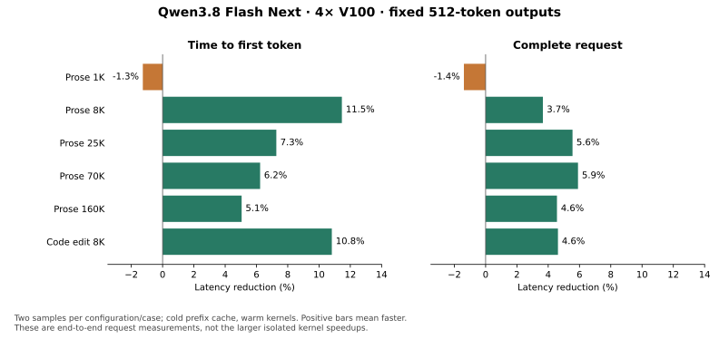

# Qwen3.8 Flash Next V100 core optimization round

This round follows the [core audit](../qwen38_nvfp4_v100_core_audit_20261103/README.md).
It improves the current memory-safe 2K prefill profile with measured MoE tuning,
a batched shared-expert gate, and grouped Page4 QSA attention. FP16 KV, native
MTP-3/4, TP4 and the 262K context limit remain the serving configuration.

## End-to-end results

The table compares two-run medians from the final baseline repeat against the
combined candidate. Every row uses the same prompt token hash, greedy settings,
and 512 output tokens, with a cold prefix cache and warm kernels.

| Case | Baseline TTFT | Candidate TTFT | Baseline request | Candidate request | Request latency change |
| --- | ---: | ---: | ---: | ---: | ---: |
| Prose 1K | 0.317 s | 0.321 s | 4.628 s | 4.693 s | **1.4% slower** |
| Prose 8K | 2.168 s | 1.919 s | 6.684 s | 6.439 s | **3.7% faster** |
| Prose 25K | 6.859 s | 6.361 s | 11.566 s | 10.923 s | **5.6% faster** |
| Prose 70K | 19.375 s | 18.167 s | 24.008 s | 22.591 s | **5.9% faster** |
| Prose 160K | 47.135 s | 44.753 s | 51.909 s | 49.541 s | **4.6% faster** |
| Code edit 8K | 2.200 s | 1.962 s | 4.990 s | 4.759 s | **4.6% faster** |

Summing one median request from each case gives **103.78 → 98.95 seconds**, a
**4.66% latency reduction**. That is an equal-case comparison, not aggregate
serving throughput. TTFT improves about 5–11% from 8K through 160K. The 1K
negative control does not benefit from the prefill paths and is slightly slower
in this sample; differences in speculative acceptance can offset small cycle
improvements.



Decode gains are small. The 20-case SPEED screen's geometric-mean decode-rate
ratio is about **+0.4% greedy** and **+0.7% sampled**. Sampled natural-EOS outputs
can differ in length, so their request latency is not a fixed-work comparison.
This round does not demonstrate a general 140 tok/s result.

## Changes retained

### MoE prefill for 2,048 tokens

The previous heuristic chose 48-row routing blocks while the SM70 native kernel
used 64-row CTAs. The new exact-shape route aligns routing to 64 rows and uses:

- Gate/up: `64x64x32x4x32x32x32`.
- Down: `64x256x32x4x64x64x32`.
- Split-K 1 and vector-word scale metadata loads.

The guard requires NVFP4, FP16, SM70, 2,048 tokens, hidden size 2,560, TP-local
intermediate size 160, 512 experts and top-k 10. Explicit user geometry settings
retain precedence. Other shapes keep their previous selectors.

Forty configurations were screened on captured inputs and routing from six real
target layers. The selected configuration was **1.153× faster** geometrically
across those cases, with at least 1.114× on every captured layer. Production
dispatch validation measured 1.13–1.18× and preserved output bits, including
changed-input graph replays. Its isolated full-model contribution was roughly
4–5% lower long-context TTFT, not a 15% end-to-end gain.

### Shared-expert gate for two/four rows

The existing one-row projection/sigmoid/multiply kernel now handles two or four
independent rows in one launch. Per-row arithmetic and FP16 rounding boundaries
are retained. The four-row microbenchmark fell from about **8.45 μs to 2.88 μs**.
The full-model effect is much smaller because this work overlaps routed experts
and acceptance varies. It remains separately switchable.

### Grouped Page4 QSA prefill

The adapter uses 1Cat-vLLM's Flash-V100 grouped Page4 planner and attention
bindings. Eight queries share selected KV pages, with per-query token masks and
Volta tensor operations. SGLang's Page16 token mapping is converted on GPU;
future selections are masked before planning. No full-context KV copy is added.

The route is limited to the measured `[2048, 6, 256]` query shape, FP16 KV,
Page16 allocation, compression ratio four, and 2,051-column structured QSA
selections. Short/ragged, FP8, and other shapes keep native QSA. These indices
contain full four-token groups and their open-group tail; this is not a generic
API for arbitrary duplicate token selections.

On four captured attention cases, planning plus attention improved **2.29–2.64×**.
Relative L2 differences against the previous implementation were approximately
`1.5e-4`–`1.8e-4`. The incremental full-model gain is smaller, particularly at
longer contexts where adjacent queries share fewer selected pages.

The dependency is rebuilt against the serving PyTorch ABI. The supplied binary
from the reference checkout could not load against PyTorch 2.9.1; the build
helper compiles the two required bindings without replacing the existing
FlashAttention package. The rebuilt library's SHA-256 is
`ebee5ccd99d82d869ae873acbea53781cb7984abf0a404f90a561b68704dac50`.

## Validation

- 44 final kernel/dispatch checks: 14 gate checks and 30 native-QSA,
  grouped-QSA and selector checks.
- Grouped attention compared with direct FP32 attention, including causal
  boundaries, partial pages, all-invalid rows, nonmonotonic physical pages,
  changing request IDs and graph replay, up to 262K positions.
- All eight text/full-context serving checks passed, including 262K retrieval,
  oversized-input rejection and the following request.
- Tool argument parsing and tool-result continuation passed.
- A long continuation reused **32,256 cached tokens** and matched a cold replay.
- All **24 queued document requests** passed; minimum sampled free memory was
  **2,100.7 MiB** on GPU 0 and at least 2,570.4 MiB on the others.
- Multimodal results remain **11/12** for both baseline and candidate. The sole
  failure is the same OCR reading of `V100` as `V10`; it is not hidden or relaxed.
- Greedy and sampled 20-case SPEED screens completed. These are small screens,
  not a broad accuracy evaluation or a replay of the user's PDF workflow.

## Experiment retained only as evidence

A compact per-warp QSA state layout removed the kernel's 48-byte stack frame
and preserved output bits, but improved the kernel only about 1–1.6% and
whole-model prefill by a fraction of a percent. Its production changes were
removed in favor of the grouped route. The source patch and measurements remain
in the archived experiment records; reproducing it requires applying that patch.

## Serving and reproduction

Use `scripts/serve_qwen38_flash_next_nvfp4_v100_mtp.sh`. The serving profile
enables these individually reversible settings:

```text
SGLANG_SM70_MTP_SHARED_GATE=1
SGLANG_SM70_MOE_PREFILL_2K=1
SGLANG_SM70_QSA_GROUPED_PREFILL=1
```

They default off in the generic runtime and on in this validated serving
profile. Set any one to `0` for a control. The prefill size remains 2,048;
this round does not reintroduce the 8K-chunk memory failure.

Build the optional grouped library in the same Python environment as SGLang:

```bash
python scripts/setup_v100_grouped_qsa.py \
  --source /path/to/1Cat-vLLM/flash-attention-v100
```

The validated source revision is `d8f42b391af06410ab01bb71657ededf7dce7799`.
The build retains source hashes and licenses. If the library is absent or cannot
load, a warning is issued and native QSA remains available; restart after
installing it. The performance result requires the grouped backend marker.

The new tools live in [qwen38_spec](../qwen38_spec/): `moe_probe/`,
`tune_moe_prefill.py`, `screen_core_candidates.py`, `screen_grouped_qsa.py`,
`prefill_ab.py`, `check_cached_document.py`, and `summarize_core_optimization.py`.
The A/B controller and tensor capture hook are for dedicated experiment servers,
not the serving environment. Captured checkpoint tensors remain local.

Full records are under `/home/rah/qwen38-runs/20261103-core-optimization/`.
The [summary](summary.json), [metadata](metadata.json), and compressed [raw
records](raw/) contain the reviewable timings and validation results without
checkpoint weights or private prompt text.

## Thanks

Thanks to D. Skryabin / ai-bond for Flash-V100, to yangzhuxinyzx for the
[grouped Page4 work in 1Cat-vLLM #387](https://github.com/1CatAI/1Cat-vLLM/pull/387),
and to the Marlin-V100 contributors for the geometry and metadata controls.
Those implementations and correctness cases made this adaptation practical.
Their [license notices](../../python/sglang/jit_kernel/third_party/flash_v100/README.md)
are retained with the adapter.
